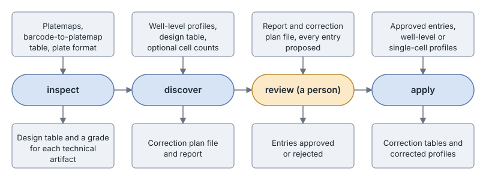

# Concepts

This page shows how the pieces of CytoDxRx relate.
The other pages define each piece; the [glossary](glossary.md) lists the terms.

## How the pieces relate

- A **platemap** says what is in each well, and a **layout** groups the plates that share an arrangement.
  `inspect` turns the platemaps into the **design table**, in which every well has one role: compound, control or empty ([inputs](inputs.md)).
- The design table decides the **identifiability grade** of each **technical artifact**: by design, under an assumption, or not identifiable ([technical artifacts](artifacts.md)).
- `discover` tests for each technical artifact on the well-level profiles and fits a correction for the ones it finds.
  It writes one entry per technical artifact to the **correction plan file**, each with its grade and its status ([correction plan file](plan-file.md)).
- A person reviews the report and marks each entry approved or rejected.
  An entry that is not identifiable cannot be approved.
- `apply` uses only the approved entries.
  The corrections are tables keyed on plate and well, so they apply to well-level profiles and to every cell in a well alike ([scope](scope.md)).
